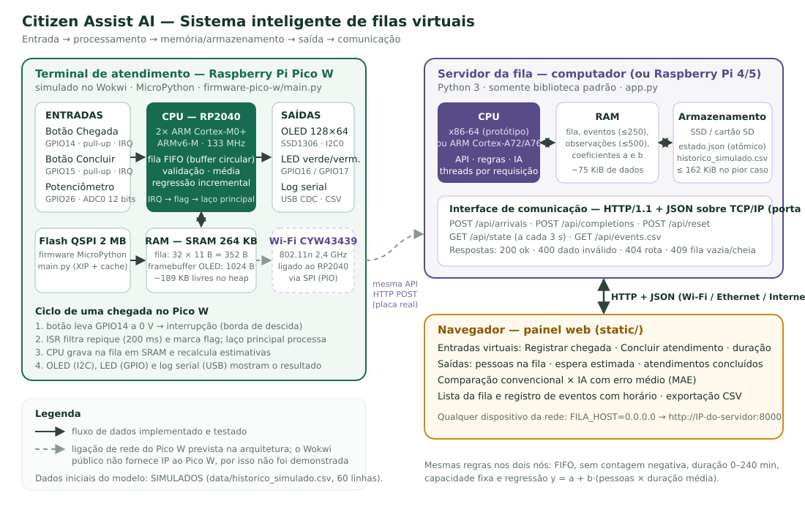

# Citizen Assist AI — Sistema Inteligente de Gerenciamento de Filas Virtuais

Global Solution 2026.2 · Arquitetura e Organização de Computadores · Turma 1CC-FEV

O protótipo tem duas partes que seguem as mesmas regras de fila:

- **Terminal de atendimento em um Raspberry Pi Pico W** (simulado no [Wokwi](https://wokwi.com)): botões físicos de chegada e conclusão, potenciômetro para a duração do atendimento, display OLED e LEDs. A fila e a previsão por regressão linear rodam no microcontrolador RP2040.
- **Servidor + painel web** em Python: recebe as operações por HTTP/JSON, registra eventos com horário, compara a estimativa convencional com a regressão linear e mostra tudo no navegador.



## Como executar

### 1. Servidor e painel web

Requisito: Python 3.10 ou superior. Não usa bibliotecas externas.

```bash
cd fila-virtual-citizen-assist
python app.py
```

Abra <http://127.0.0.1:8000>. No Windows também funciona `py app.py`. Para encerrar, pressione `Ctrl+C`.

Para acessar de outro computador ou celular da mesma rede (PowerShell):

```powershell
$env:FILA_HOST = "0.0.0.0"; python app.py
```

Em seguida abra `http://IP-DO-COMPUTADOR:8000` no outro aparelho; o firewall pode pedir permissão.

O estado fica em `data/estado.json`, criado automaticamente e ignorado pelo Git. O botão **Reiniciar** do painel zera a demonstração.

### 2. Terminal Raspberry Pi Pico W (Wokwi)

1. Abra <https://wokwi.com/projects/new/micropython-pi-pico-w>.
2. Cole [`firmware-pico-w/main.py`](firmware-pico-w/main.py) na aba **main.py** e [`firmware-pico-w/diagram.json`](firmware-pico-w/diagram.json) na aba **diagram.json**.
3. Clique em ▶. Use os botões **Chegada** e **Concluir** e gire o potenciômetro para mudar a duração.

Detalhes, pinagem e o log de uma execução real: [firmware-pico-w/README.md](firmware-pico-w/README.md).

### 3. Testes automatizados

```bash
cd fila-virtual-citizen-assist
python -m unittest discover -s tests -v
```

São 12 testes, entre eles os quatro cenários mínimos do enunciado. Todos passam.

## Requisitos do enunciado × onde estão atendidos

| Requisito | Onde |
| --- | --- |
| **Etapa 1** — diagrama com CPU, RAM e armazenamento, entradas, saídas e interface de internet; fluxo de informações | [docs/diagrama-arquitetura.svg](docs/diagrama-arquitetura.svg), [docs/arquitetura.md](docs/arquitetura.md) |
| **Etapa 2** — chegada por botão, conclusão por outro botão, atualização automática, bloqueio de contagem negativa e operações inválidas, total na fila, eventos com horário | `firmware-pico-w/main.py` (botões GP14/GP15, OLED, log serial); `app.py` (API, validações, `events.csv`); `static/` (painel) |
| **Etapa 3** — estimativa por média histórica × regressão linear, com dados simulados identificados | `app.py` (`regression`, `evaluate`), `data/historico_simulado.csv` (coluna `origem = simulado`), `tools/gerar_historico.py`; relatório, seção 4 |
| **Etapa 4** — interface web com fila, espera estimada, concluídos e atualização pela comunicação com o sistema | `static/index.html` + `static/app.js` (consulta `GET /api/state` a cada 3 s) |
| **Etapa 5** — processador, memória e uso, entrada/processamento/saída, protocolos, limitações | [docs/relatorio-tecnico.md](docs/relatorio-tecnico.md), seção 6 |
| **Entregável 01** — protótipo funcional | servidor + painel; terminal Pico W no Wokwi |
| **Entregável 02** — diagrama de arquitetura | `docs/diagrama-arquitetura.svg` |
| **Entregável 03** — código-fonte documentado com instruções | este README e os comentários do código |
| **Entregável 04** — relatório técnico | [docs/relatorio-tecnico.md](docs/relatorio-tecnico.md) |
| **Entregável 05** — vídeo de até 5 min | roteiro em [docs/roteiro-demonstracao.md](docs/roteiro-demonstracao.md) (a gravação é feita pela equipe) |
| **Testes mínimos** (1) chegada (2) conclusão (3) saída com fila vazia (4) atualização da estimativa | `tests/test_fila.py`, [docs/plano-de-testes.md](docs/plano-de-testes.md) |

## Estrutura

```
fila-virtual-citizen-assist/
├── app.py                     servidor HTTP, regras da fila, persistência, modelo
├── static/                    painel web (HTML, CSS, JavaScript)
├── firmware-pico-w/           terminal Raspberry Pi Pico W (MicroPython + circuito Wokwi)
├── data/historico_simulado.csv  60 registros SIMULADOS para treinar o modelo
├── tools/gerar_historico.py   gera o CSV simulado (semente fixa, reproduzível)
├── tests/test_fila.py         testes automatizados (unittest)
└── docs/                      arquitetura, diagrama, relatório, plano de testes, roteiro
```

## API

| Método e rota | Função |
| --- | --- |
| `GET /api/state` | estado da fila, estimativas, modelo e últimos eventos |
| `POST /api/arrivals` | registra chegada |
| `POST /api/completions` com `{"duration_minutes": 7}` | conclui o atendimento da primeira pessoa |
| `POST /api/reset` | reinicia a demonstração |
| `GET /api/events.csv` | exporta o registro de eventos |

Erros: `400` dado inválido · `404` rota inexistente · `409` fila vazia ou cheia.

## Limitações

- Os dados iniciais do modelo são **simulados**. O ganho da regressão (MAE 2,86 contra 3,35 min) vale para esse cenário e precisaria ser validado com dados reais.
- No Wokwi público o Wi-Fi do Pico W não recebe IP. A comunicação em rede é demonstrada pelo servidor; na placa real, o terminal usaria a mesma API.
- O servidor usa HTTP sem autenticação, adequado para rede local. Para internet pública seriam necessários HTTPS, login e hospedagem.
