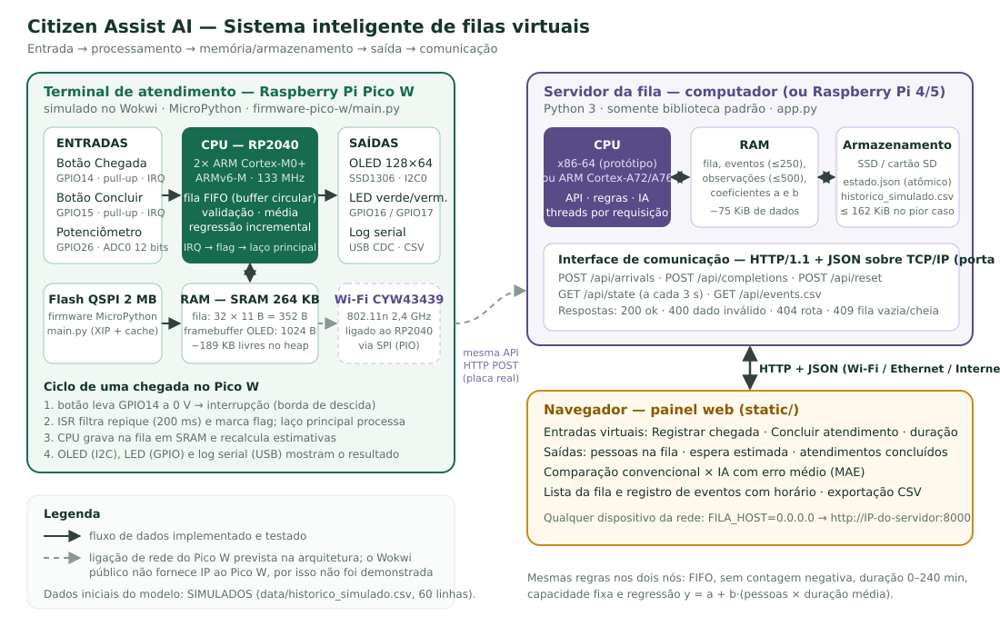
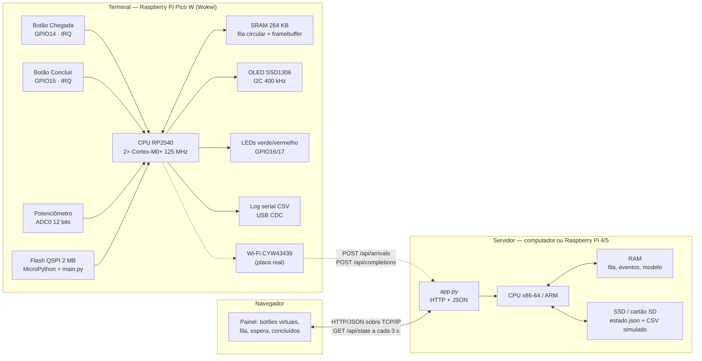

# Arquitetura do sistema (Etapa 1)

## Diagrama

Arquivo vetorial: [diagrama-arquitetura.svg](diagrama-arquitetura.svg) (abre em qualquer navegador e pode ser inserido no relatório ou nos slides).

Versão em texto (Mermaid, renderizada pelo GitHub):

## Componentes obrigatórios

| Exigência do enunciado | No terminal (Pico W) | No servidor + navegador |
| --- | --- | --- |
| Unidade central de processamento | RP2040: 2 núcleos ARM Cortex-M0+ (ARMv6-M), 125 MHz medido no simulador | CPU x86-64 do computador que executa `app.py` (pode ser trocada por um Raspberry Pi 4/5, ARM Cortex-A72/A76) |
| Memória RAM | SRAM 264 KB; heap MicroPython com 12 KB usados e 193 KB livres | RAM do computador; processo do servidor com ~23 MB de working set |
| Armazenamento | Flash QSPI 2 MB (firmware e `main.py`, executados via XIP) | SSD: `data/estado.json` (gravação atômica) e `data/historico_simulado.csv` |
| Dispositivos de entrada | 2 botões físicos (GPIO + interrupção) e potenciômetro (ADC) | botões virtuais e campo de duração no navegador |
| Dispositivos de saída | display OLED (I2C), 2 LEDs (GPIO), log serial (USB) | painel web (tela), exportação CSV |
| Interface com a internet | Wi-Fi 802.11n do CYW43439 (previsto; indisponível no Wokwi público) | HTTP/1.1 + JSON sobre TCP/IP; com `FILA_HOST=0.0.0.0` o painel fica acessível por outros dispositivos da rede |

## Fluxo de informações

### Chegada registrada no terminal físico (Pico W)

1. O cidadão aperta o botão verde. O pino GP14, mantido em 3,3 V pelo pull-up interno, cai para 0 V.
2. O controlador de interrupções detecta a **borda de descida** e desvia a CPU para a rotina de interrupção (ISR).
3. A ISR só compara o tempo com o último toque (filtro de repique de 200 ms) e liga uma flag. Ela termina em poucos microssegundos.
4. O laço principal vê a flag e chama `arrival()`. A CPU lê e escreve o **buffer circular na SRAM**: grava o identificador, quantas pessoas estão à frente e a duração média no momento.
5. A CPU recalcula a estimativa convencional e a da regressão (operações em ponto flutuante feitas por software, pois o Cortex-M0+ não tem FPU).
6. Saídas: o *framebuffer* de 1024 bytes é redesenhado na SRAM e enviado ao OLED pelo barramento I2C; o LED verde pisca (GPIO); uma linha CSV com data e hora vai para a porta serial USB.

### Chegada registrada pelo painel web

1. O operador clica em **Registrar chegada**. O JavaScript envia `POST /api/arrivals` com um corpo JSON.
2. O pacote atravessa a pilha TCP/IP até a porta 8000. O `ThreadingHTTPServer` cria uma *thread* para a requisição.
3. Com um *lock* (exclusão mútua), o servidor carrega o estado do disco para a RAM, valida a operação, atualiza a fila e registra o evento com horário ISO 8601.
4. O estado é gravado de forma atômica no SSD (arquivo temporário seguido de `replace`). Assim, uma queda de energia não deixa o JSON pela metade.
5. A resposta JSON volta ao navegador com os novos indicadores. Os outros navegadores abertos recebem a atualização na próxima consulta `GET /api/state` (a cada 3 s).

### Conclusão com fila vazia (operação inválida)

- **Pico W:** `count == 0` → nada é alterado, o LED vermelho pisca, o display mostra `! FILA VAZIA` e o log registra `rejeitado`.
- **Servidor:** responde HTTP `409 Conflict`; fila e concluídos não mudam; o contador de operações recusadas aumenta e o evento `rejeitado` fica no histórico.

## Papel de cada componente

- **Processador:** busca e executa as instruções (MicroPython compilado para *bytecode* no Pico; CPython no servidor), aplica as regras da fila, faz as contas da média e da regressão e coordena as interfaces de E/S.
- **Memória principal (RAM/SRAM):** guarda os dados em uso: fila, contadores, somatórios do modelo, *framebuffer* do display e as estruturas da requisição HTTP. O conteúdo é volátil.
- **Armazenamento (flash/SSD):** guarda o que precisa sobreviver ao desligamento: o programa (flash do Pico), o estado da fila e o histórico de treinamento (SSD do servidor).
- **Entradas:** convertem ações físicas (botão, giro do potenciômetro) ou virtuais (clique) em dados digitais.
- **Saídas:** mostram o resultado para pessoas (display, LEDs, painel) e para análise (log serial e CSV de eventos).
- **Comunicação:** I2C (CPU ↔ display), USB (CPU ↔ computador), HTTP/JSON sobre TCP/IP (navegador ↔ servidor) e Wi-Fi 802.11n como enlace previsto para o terminal.

## Operações de entrada, processamento e saída

| Tipo | Terminal Pico W | Servidor + painel |
| --- | --- | --- |
| Entrada | botão (GPIO/IRQ), potenciômetro (ADC) | `POST /api/arrivals`, `POST /api/completions` com JSON |
| Processamento | enfileirar/desenfileirar no buffer circular, validar, média, regressão incremental | validar, FIFO, relógio de serviço, regressão, validação cruzada (MAE) |
| Saída | OLED (I2C), LEDs (GPIO), CSV na serial (USB) | JSON de resposta, painel web, `GET /api/events.csv` |
