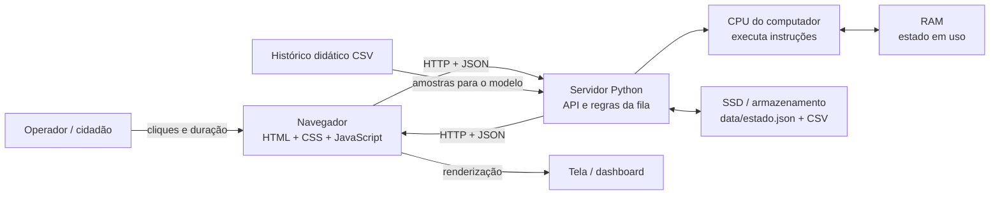

# Arquitetura do protótipo

## Diagrama

## Caminho de uma chegada

1. O operador seleciona **Registrar chegada** no navegador. Esse botão virtual representa um dispositivo de entrada.
2. O JavaScript envia uma requisição HTTP `POST /api/arrivals` com JSON.
3. O servidor Python valida a operação, cria um identificador e grava a hora local com fuso.
4. A CPU executa as instruções; os dados ativos são manipulados na RAM.
5. O servidor persiste a fila e o evento em `data/estado.json`, no armazenamento secundário.
6. A API devolve o novo estado em JSON. O navegador atualiza os cartões, a lista e o histórico; essa tela representa a saída.

## Componentes e organização

- **Processador:** CPU do computador que executa Python e o navegador. O protótipo não depende de um microcontrolador dedicado. Uma implementação embarcada futura poderia usar ESP32, que acrescentaria Wi-Fi e botões físicos.
- **Memória principal:** RAM do computador mantém o processo do servidor, as estruturas de fila/eventos e o estado carregado durante cada operação. O volume é pequeno: no máximo 250 eventos recentes e 500 durações observadas, além da fila corrente.
- **Armazenamento:** SSD/HD guarda o estado persistente em JSON e a amostra de treinamento em CSV. O JSON é regravado de forma atômica usando arquivo temporário e substituição.
- **Entradas:** botões virtuais de chegada/conclusão e campo numérico da duração do atendimento. A API também valida o número para evitar valores fora do intervalo permitido.
- **Saídas:** dashboard no navegador, mensagens de validação e registros de evento com data/hora.
- **Comunicação:** HTTP com payloads JSON entre navegador e servidor no endereço local `127.0.0.1:8000`. A atualização periódica consulta `GET /api/state` a cada três segundos.

## Operações de entrada, processamento e saída

| Tipo | Exemplo |
| --- | --- |
| Entrada | chegada, conclusão e duração do atendimento |
| Processamento | validar ação, enfileirar/desenfileirar, calcular média e regressão linear |
| Saída | quantidade na fila, conclusões, tempos estimados e histórico de eventos |

## Estimativas

A estimativa convencional multiplica a quantidade atual na fila pela média das durações de atendimento. A regressão linear aprende uma reta `y = a + b × x`, na qual `x` é `pessoas à frente × duração média de atendimento` e `y` é o tempo observado. O conjunto inicial é sintético e está identificado no CSV; observações da execução são acrescentadas ao treinamento quando um atendimento é concluído. É um modelo demonstrativo, não uma previsão validada para uso real.
